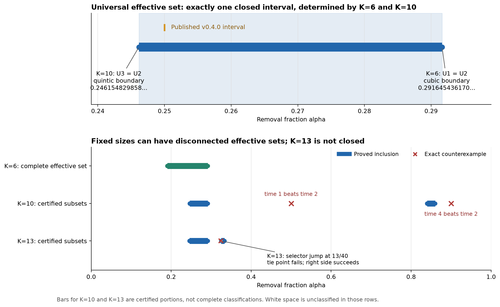

# Alpha phase diagram and boundary mechanisms

Post-release research dated 27 October 2026, Asia/Shanghai.
Canonical initial state, XO law, maximum cumulative-excess prefix,
minimum-index tie rule, activity threshold and quadratic loss are unchanged.
The published v0.4.0 snapshot remains immutable.

**The universal parameter set can be characterized exactly.** Define
\(W_K=\{\alpha\in(0,1):U(p_t)\ge U(p_2)\text{ for all integer }t\ge0\}\).
The new computer-assisted theorem is

\[
 \boxed{\bigcap_{K\ge6}W_K=W_6\cap W_{10}=[a_-,a_+]}
\]

with

\[
 a_-=0.24615482985838558\ldots,\qquad
 a_+=0.29164543617016553\ldots.
\]

These are exact algebraic endpoints, including their equality cases:

| Boundary | Exact defining polynomial, unique root in the stated interval | Binding size/time | Mechanism |
|---|---|---|---|
| Lower a_- | 42889525a^5 - 240679790a^4 + 555506236a^3 - 613816360a^2 + 272381200a - 37296000 = 0, a in (6/25,1/4) | K=10; U3=U2 | Simple loss-branch crossing on the unchanged word (5,7,8) |
| Upper a_+ | 1164a^3 - 4361a^2 + 5068a - 1136 = 0, a in (19/100,1/3) | K=6; U1=U2 | Simple loss-branch crossing on the unchanged word (3,4) |

The polynomials are irreducible modulo 29 and 11 respectively, so the
endpoints have algebraic degrees 5 and 3 and are irrational. They are not
fitted numerical thresholds or assumed rational endpoints. Exact rational
root brackets, uniqueness checks and all sign evidence are saved with the
[verification code](../../experiments/alpha_phase_2026_10_27/verify_all.py).

The global set is one closed interval even though individual fixed-size
sets can be disconnected and nonclosed. Connectedness was a conclusion
of the two inclusions, not an assumption used to organize a scan.



**Why these two sizes suffice.** Every alpha below a_- fails at K=10,
time 3. Every alpha above a_+ fails at K=6, at time 1 or time 0 according
to the branch. Conversely, all parameters in the closed interval pass for
every size and every integer time. In fact,

\[
 [123/500,7/24]\subset W_K\quad(K\ge7,\ K\ne10).
\]

Every other size therefore admits a common interval extending strictly
beyond both endpoints. The universal boundaries are finite-size effects;
neither comes from an asymptotic orbit, a selector change, or a hidden
large-K obstruction. The large-K proof covers the switch of dominant
first-step peak near 16/63 by enclosing both branches. It does not assume
a unique continuum state at the switch.

For alpha strictly between the sharp endpoints, time 2 is the unique
global minimizing integer time for every K. At a_-, K=10 has exactly
times 2 and 3 tied. At a_+, K=6 has exactly times 1 and 2 tied. Both
endpoints belong to the effective set under the requested non-strict
inequality.

**Fixed-size structure is richer.** The following are all-time statements,
not finite-time scan classifications.

| Size/range | Proved result | Scope |
|---|---|---|
| K=6 | W6=[a6,a_+], a6=0.19040773653717682... | Complete characterization; a6 is the unique root in (19/100,1/5) of 2328a^5-13378a^4+32735a^3-38636a^2+17183a-2080 |
| K=10, near the universal lower edge | W10 intersect (6/25,1/4]=[a_-,1/4] | Exact local characterization |
| K=10, distant parameters | [21/25,43/50] is contained in W10, whereas 1/2 is not | W10 is disconnected; full endpoints of the distant component are not claimed |
| K=13 | (13/40,1/3] is contained in W13, whereas 13/40 and 81/250 are not | W13 is disconnected and is not closed in (0,1) |
| Every K>=7 other than 10 | [123/500,7/24] is contained in W_K | Continuous real alpha and all integer times; finite complement plus uniform theorem |

At K=13, alpha=13/40 is a genuine selector boundary. The time-1 selector
at the tie is 9, while the branch immediately to its right selects 10.
The actual tie fails:

\[
 U_1-U_2=-31191/22497280<0.
\]

The right-hand time-2 loss is lower by exactly

\[
 U_2(13/40+)-U_2(13/40)=-155929/16224000.
\]

The newly admitted right-hand interval is open at the tie. This gives a
rigorous example of a boundary caused by a selector jump, in contrast to
the two universal endpoints, where the relevant selector words stay fixed.

**A fourth-state counterexample prevents an overly short fixed-K test.**
At K=10, alpha=9/10, the exact word begins (5,8,9,8). All of U0, U1 and
U3 exceed U2, but

\[
 U_4-U_2=-4697222139/20000000000000<0.
\]

Thus testing times 0,1,2,3 alone cannot characterize arbitrary fixed-K
effective sets. This is a finite transient effect. The universal theorem
has a separate infinite tail proof, so this example creates no missing
late-time quantifier in the sharp interval.

The two supplied historical counterexamples were reproduced unchanged:
K=9, alpha=1/5 gives U3-U2=-83303117/5978711250; K=6, alpha=7/24 gives
U1-U2=-161/11943936. They fit the two boundary mechanisms above.

**How the infinite quantifiers are discharged.** The full derivation is in
[PROOF.md](PROOF.md); [verification.json](../../experiments/alpha_phase_2026_10_27/verification.json)
records the actual commands, exits, source hashes and preservation checks.

* Exact low-dimensional polynomial proofs give the global exclusions,
  the complete K=6 set, and the K=10 lower endpoint including its tie.
* The finite complement K=7..203, excluding 10, has 1,045 rational closed
  cells; K=10 has one additional upper cell. Each covers real parameters
  and all integer times. The witness is reconstructed with both rational
  Bernstein signs and a separate exact Sturm pass. The latest needed
  tail start is time 5.
* For every K>=204, a two-peak enclosure of the actual first selector and
  exact residue-dependent moment identities lead to rational boxes over
  alpha, h=1/K and the rounding error. They prove boundary entry, times
  0 and 1, and the entire tail. The uniform strict bounds include
  U1-U2>1/1000 and U_t-U2>1/200 for every t>=3, throughout the broader B.
* Sixty identities in formal polynomial variables independently compare
  bin sums with the density/variance formulas for both branches and all
  residues. Exact full-vector and integer-mass checks provide additional
  implementation checks. They do not replace the analytic quantifiers.
* The published baseline verification is rerun, with its 37 frozen inputs
  checked before and after. The October 27 review and correction records
  and the pre-existing maintained documents are also preserved.

The standard-library reproduction command is

```text
python -B experiments/alpha_phase_2026_10_27/verify_all.py
```

The completed end-to-end run passed all six stages in approximately 231
seconds. Its ordinary finite complement contains 242,579 sign obligations;
the independent Sturm pass rechecked 1,046 cells including K=10. The
uniform proof evaluated 20,554 boxes and accepted 11,813 terminal boxes
covering all 3,072 initial boxes. Every terminal box exceeded the stated
strict rational margins. The final baseline replay passed 6/6 checks with
all 37 frozen scientific inputs unchanged. These are execution counts,
not additional mathematical hypotheses.

**What remains open.** There is no remaining parameter or time gap in the
new universal interval under the documented proof premises. The complete
fixed-K phase diagram is still open outside the certified subsets. In
particular, this investigation does not prove a bound on the number of
components of W_K, an exact description of all distant islands, or a
finite time horizon that decides membership for arbitrary K and alpha.
Additional components in the exploratory census remain finite computational
observations unless covered by the exact results above.

The next mathematical question with the most structural value is whether
each fixed-K effective set admits a finite description by algebraic
intervals and isolated endpoints, or whether later boundary itineraries
can create infinitely many components or accumulation boundaries. The
K=13 half-open boundary and K=10 fourth-state obstruction show why this
question needs more than root finding for U1-U2 and U3-U2. A focused first
case is the complete distant K=10 component, including whether its upper
edge is determined by time 4 or by an even later orbit segment.

**Evidence limits and provenance.** This result is a new computer-assisted
proof in the unchanged model, not a new release and not independently
reviewed by a human mathematician. It inherits Theorem A's invariants and
permanent residence and uses standard exact interval and polynomial
reasoning. Its original code and evidence remain distinguishable from
v0.4.0. The current proof does not assert novelty or a physical sand law.

The exploratory scan used K=6..120, alpha=j/1000, and time horizon 400.
It enforces the first two selectors exactly; later numerical selectors
and apparent components still require exact checks. An initial floating
implementation mishandled odd-K initialization ties and produced, among
other artifacts, a spurious extra K=11 component. That implementation was
corrected before the saved census; none of the theorems depends on its
floating classifications. Earlier failed uniform trials recorded interval
overestimation, not true negative trajectories; the final proof refines
boxes and restricts each peak to a justified overlapping alpha range.
